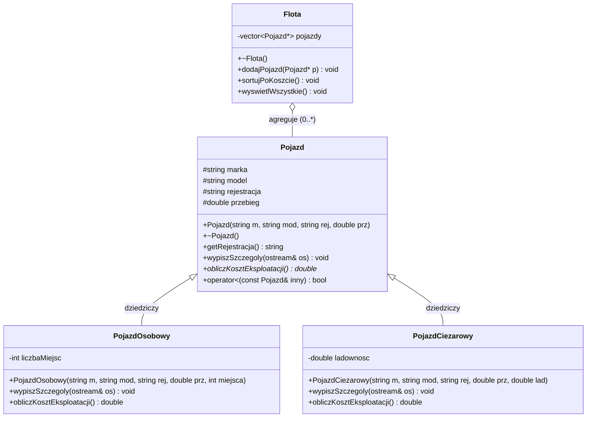

# System Zarządzania Flotą Pojazdów

Konsolowy program napisany w języku C++ realizujący ewidencję pojazdów we flocie, obliczanie kosztów ich eksploatacji, sortowanie oraz walidację danych z wykorzystaniem programowania obiektowego.

## Architektura projektu
- **`Pojazd` (`Pojazd.h`, `Pojazd.cpp`)** – klasa bazowa przechowująca wspólne atrybuty (`marka`, `model`, `rejestracja`, `przebieg`), definiująca wirtualne metody `wypiszSzczegoly` oraz czysto wirtualną `obliczKosztEksploatacji`, a także przeciążone operatory `<` i `<<`.
- **`PojazdOsobowy` oraz `PojazdCiezarowy`** – klasy pochodne dziedziczące publicznie po klasie `Pojazd`, posiadające własne atrybuty (`liczbaMiejsc`, `ladownosc`) oraz przesłaniające metody wirtualne (`override`).
- **`Flota` (`Flota.h`, `Flota.cpp`)** – klasa zarządzająca kolekcją wskaźników `Pojazd*` (`std::vector`), odpowiadająca za dodawanie pojazdów, sortowanie po koszcie eksploatacji, wyświetlanie listy oraz zwolnienie pamięci w destruktorze.
- **`main.cpp`** – punkt wejścia programu udostępniający interaktywne menu w konsoli (dodawanie pojazdów osobowych i ciężarowych, wyświetlanie listy, sortowanie po koszcie oraz obsługa wyjątków `try` / `catch`).

## Schemat klas UML



## Kompilacja i uruchomienie

### Za pomocą kompilatora MSVC (Developer PowerShell for VS)
```cmd
cl /EHsc main.cpp Pojazd.cpp Flota.cpp /Fe:flota.exe
.\flota.exe
```

### Za pomocą kompilatora g++
```bash
g++ -std=c++17 main.cpp Pojazd.cpp Flota.cpp -o flota
./flota
```

## Przykładowe działanie programu
Po uruchomieniu programu w konsoli wyświetla się interaktywne menu pozwalające na podgląd aktualnej floty (wypisywanej z użyciem przeciążonego operatora `<<`), dodawanie nowych pojazdów osobowych i ciężarowych z walidacją danych (obsługa wyjątków przy ujemnym przebiegu, pustej rejestracji lub niedodatniej ładowności/liczbie miejsc) oraz sortowanie rosnące po koszcie eksploatacji (z użyciem przeciążonego operatora `<`).